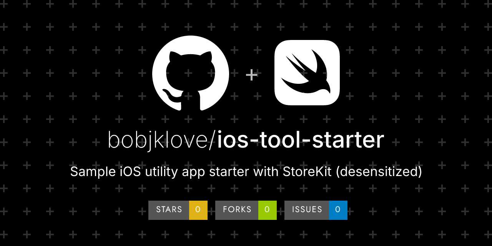

# ios-tool-starter

SwiftUI + StoreKit2 starter for a simple iOS utility. SwiftUI+StoreKit2 工具脚手架样品。

> **Sample / 样品** — not a production deliverable.  
> Fictional data only. No real merchants, payments, or customer PII.  
> 虚构数据；不含真实商户、真实支付或个人隐私。

## Demo

- Screenshots: _(add after first cut)_
- Live / video: _(optional; no real accounts)_

## What this is (and isn't)

| This sample **is** | This sample **is not** |
|---|---|
| A runnable slice you can clone and try | A finished product for a real business |
| Fictional shop / demo data | Real merchants, orders, or user PII |
| MIT/Apache licensed for learning & forking | A substitute for a scoped custom build |

## Quick start

```bash
git clone https://github.com/bobjklove/ios-tool-starter.git
cd ios-tool-starter
# Requires macOS + Xcode 15+ and xcodegen (brew install xcodegen)
xcodegen generate
open ToolStarter.xcodeproj
# Run the ToolStarter scheme on a simulator.
# Local StoreKit config: ToolStarter.storekit
# Sample product id: com.example.toolstarter.unlock (non-consumable)
```

Optional checks on a Mac with Xcode:

```bash
python3 tools/scan-sensitive.py
# Default test plan (unit + local StoreKit): see ToolStarter.xctestplan
```

## Scope

| In sample | Not in sample (typical custom add-ons) |
|---|---|
| SwiftUI sample flow · free N exports then paywall · StoreKit2 non-consumable unlock · en/zh/ja strings · screenshot UITest hooks · xcodegen project.yml | Real App Store Connect account · Team ID / signing · shipping bundle id · production SKUs · custom domain features · CI secrets |

## Stack

SwiftUI · StoreKit2 · XcodeGen · XCTest / StoreKitTest

## Custom work / 定制

Need the same idea for a **real** business (pay, printer, multi-store, your schema, App Store build, …)?

- Email: **ddxxdtt@gmail.com** (Bob Wei)
- Or open a GitHub Issue with the **custom-inquiry** template: https://github.com/bobjklove/ios-tool-starter/issues/new?template=custom-inquiry.yml

Samples are free to fork under the license below.  
**Custom delivery is a separate contract, scoped and quoted — no fixed price on this page.**  
样品可 fork；**定制另签合同、按范围报价；本页不挂固定价。**

Need a production tool app from this starter? Email with your feature list for an estimate.

## License

MIT License — see [`LICENSE`](./LICENSE).

Open-source license ≠ custom delivery.  
开源许可 ≠ 定制交付；定制源码交付节点以合同为准。
